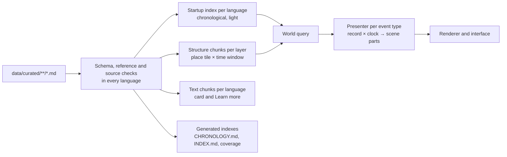

# Content format

How historical content (events, famous people, eras, places, polities, routes, culture profiles, landmarks and vignettes) is written, validated, indexed and fed into the app. The lists of what is in the app are in [events.md](events.md), [people.md](people.md) and [eras.md](eras.md); this file defines the format every item on those lists is stored in.

Goals: adding an item is only data; adding a new kind of event is one presenter; adding a new kind of content is one schema and one build step; every record is reviewable in both languages; nothing about a record has to be maintained in two places.

## 1. Records

Every piece of content is a **record**: one Markdown file under `data/curated/<kind>/`, named by its id. Structured fields sit in a YAML front matter block at the top; the text the viewer reads sits below it under a fixed set of headings, in English and German side by side.

```
data/curated/
  vocab/        event-types.yaml, effect-types.yaml, people-categories.yaml,
                lanes.yaml, regions.yaml, tags.yaml, actions.yaml, roles.yaml,
                animals.yaml, icons.yaml
  eras/         roman-republic.md ...
  events/       vesuvius-79.md, black-death.md ...
  people/       julius-caesar.md ...
  places/       rome.md, pompeii.md ...       settlements and named places
  polities/     roman-empire.md ...            states and empires
  routes/       silk-road.md ...
  cultures/     roman-imperial.md ...          culture profiles
  landmarks/    gobekli-tepe.md, great-pyramid.md ...
  vignettes/    viking-raids-britain.md ...    small looping stories
  animals/      lion.md, thylacine.md ...      wildlife species cards
  templates/    coastal-raid.yaml ...          vignette stages and scripts (no text)
  geo/          areas and paths as GeoJSON, referenced by id
  sources.yaml  bibliography of content sources (books, papers, databases)
  CHRONOLOGY.md, <kind>/INDEX.md               generated (section 8)
data/schema/    one schema per kind, shared by the data build and the app
```

- One file per record keeps pull requests small: a change touches only the records it is about, and a reviewer reads one item at a time.
- The front matter is parsed strictly as YAML 1.2 with no implicit type guessing, so `no` stays a string and `1.10` is not a number. Plain Markdown tables are not used for records, because they cannot hold nested data such as paths, phases or effects.
- **Vocabularies are data.** Event types, effect types, people categories, timeline lanes, regions, tags, vignette actions, roles, animals and scene-marker icons each live in one YAML file under `vocab/`, every entry keyed by its id (`lanes.yaml`, whose order matters, is a list), with `en` and `de` labels where the viewer reads them. Code and records refer to vocabulary ids only, never to labels. Each vocabulary file has a schema in `data/schema/` (section 7), and the data build fails on an entry that does not match it.
  - `actions.yaml`: per action, whether it is for cast groups or props (`for: cast` or `for: prop`) and what its object names (`object: none`, `mark`, `group` or `optional-group`). The movement rule and the clips are the action's code in the vignette player, which implements exactly the actions in this file.
  - `roles.yaml`: per role, an `en` label and German labels in the feminine and masculine form (`de: { female, male }`), and the rules the cast follows: `man: true` when the role is always played by a man of the profile, and `tool` for the tool the role holds instead of the profile's own.
  - `animals.yaml`: per animal, its `en` and `de` names. The animal's model has the id `animal-<id>` (milestone 2, section 13).
  - `icons.yaml`: the scene-marker icons the app can draw (milestone 2, section 7.2), with their labels.
  - **Regions and lanes.** `vocab/regions.yaml` maps each world region's id to its labels, in the order of [spec.md section 7.1](spec.md#71-timeline): `europe`, `mena`, `africa`, `central-asia`, `south-asia`, `east-asia`, `southeast-asia`, `americas`, `oceania`. `vocab/lanes.yaml` lists the timeline lanes from top to bottom: the World lane as `{ id: world, en: World, de: Welt }`, then one entry `{ region: <id> }` per region, which takes the region's id and labels, so a region's name is written once. The data build fails when a region has no lane, has two, or a lane names an unknown region.

## 2. The record envelope

Every record, whatever its kind, has the same envelope:

```markdown
---
id: vesuvius-79
kind: event
type: natural-disaster
when: { from: 79-10-24, to: 79-10-25 }
where: { place: pompeii }
region: europe
sources:
  - ref: smithsonian-gvp
  - ref: pliny-letters
    note: Letter 6.16
debated: date
tags: [volcano]
links: { people: [pliny-the-elder], eras: [roman-empire-principate] }
---

## en

# Vesuvius buries Pompeii

Mount Vesuvius erupts and buries the town of Pompeii under ash. ...

### Learn more

The letters of Pliny the Younger give 24 August, but finds in the town point to October. ...

## de

# Der Vesuv verschüttet Pompeji

Der Vesuv bricht aus und begräbt die Stadt Pompeji unter Asche. ...

### Mehr erfahren

...
```

| Field | Required | Meaning |
| --- | --- | --- |
| `id` | yes | Stable lowercase slug, unique within its kind, equal to the file name. Never reused; a renamed record keeps its old id in `aliases`, so bookmarks, links and later guided tours never break. |
| `kind` | yes | `event`, `person`, `era`, `place`, `polity`, `route`, `culture`, `landmark`, `vignette` or `animal`; must match the folder. |
| `when` | yes, except culture and animal | Time span (section 3). |
| `where` | yes for events, people, places, routes, landmarks and vignettes | Place (section 4). |
| `region` | yes, except culture, animal and era (an era's `lane` places it) | One or more region ids from `vocab/regions.yaml` (the timeline's regional lanes); used for the timeline, the phone lane filter and the coverage report. |
| `sources` | yes | One or more references into `sources.yaml`, each with an optional note such as a page or letter number. |
| `debated` | no | What historians dispute: `date`, `place`, `cause`, `numbers` or `method` (how something was done, such as whether people killed mammoths or collected the bones of dead ones). The data build fails on any other value. The card says so in plain words. |
| `tags`, `links` | no | Tag ids, and links to other records by kind and id. |
| `aliases` | no | Former ids. |

**Text.** The body has one section per supported language (`## en`, `## de`). Each holds the title as a `#` heading, then the card text written for a reader of about 11 to 12, then an optional `### Learn more` (`### Mehr erfahren`) section for adults. Kinds without cards, such as eras, have only the title, and the build fails on any other text in them. The title goes into the startup index; the card and "Learn more" go into text chunks loaded when a card opens (section 7).

**Validation.** The data build fails when a record has an unknown field, a heading outside this fixed set, a missing language section or text that the other language has, a reference (`place`, `links`, `sources`, `type`, `region`, `tags`, asset ids) that points nowhere, or a date it cannot parse. These checks join those of [milestone-1.md](milestone-1.md#108-data-build-validation) section 10.8. A new field is added by changing this file and the schema first.

## 3. Time

Dates are written in a small human-readable form and converted by the data build into the whole-day integers of [milestone-1.md](milestone-1.md#31-dates) section 3.1.

| Written | Means |
| --- | --- |
| `2560 BCE` | the year 2560 BCE (precision: year) |
| `c. 2560 BCE` | approximate; the app shows "c." / "ca." |
| `79`, `1492` | years CE |
| `1342-07` | July 1342 (precision: month) |
| `1789-07-14` | a single day |
| `start`, `today` | the start of the timeline, the content cutoff |

Years CE are written without a suffix and with four or fewer digits; there is no year 0 in written dates (the build converts to astronomical numbering).

`when` has the same shape for every kind:

```yaml
when:
  from: c. 541
  to: c. 750
  peak: { from: 541, to: 549 }
  phases:
    - { id: wave-2, from: 558, to: 561, where: { place: constantinople } }
```

- `from` and `to` each carry their own precision and approximate flag, so "c. 1600 BCE to 1450 BCE" is expressible. A date of year precision covers the whole year, a month the whole month.
- A single date (`when: 79`) is shorthand for `from` and `to` being the same.
- `peak` is the moment or phase of greatest force (the "Peak" of the disaster list). `phases` are named sub-spans with an optional place of their own, such as the later waves of a plague or the battles of a war.
- For a person `when` is their life (with `active` for the part of it they appear on the globe, section 5); for an era it is its range on the timeline; for a place it is from founding to abandonment, if any.
- An era's `from` and `to` are boundaries between eras rather than spans: its range runs from the first day of its `from` year to the first day of its `to` year, so an era that ends in 27 BCE and the next that begins in 27 BCE meet without overlapping, and `today` ends it on the last day of the timeline. An era has no `peak` or `phases`.

## 4. Place

`where` takes one of four forms:

| Form | Example | Used for |
| --- | --- | --- |
| `place: rome` | a place record, with names per language and per period | most events, buildings, people |
| `point: [40.75, 14.49]` | latitude and longitude in degrees | one-off sites with no place record |
| `area: geo/black-death-1348` | a GeoJSON polygon, or a list of region ids | wars, epidemics, climate shifts, culture regions |
| `path: [...]` | a list of dated waypoints | voyages, migrations, routes, the movements of famous people |

```yaml
where:
  path:
    - { at: 100 BCE, place: rome }
    - { from: 58 BCE, to: 50 BCE, area: geo/gaul }
    - { at: 49 BCE, place: rubicon }
    - { from: 48 BCE, to: 47 BCE, place: alexandria }
    - { at: 44 BCE, place: rome }
```

Between waypoints the position is interpolated along the path by date, so where something is at any date is a pure function of the record. Every record also gets an **anchor**, the point the camera flies to: the place or point itself, the centre of an area, or the waypoint for the current date on a path. A record may set `anchor` explicitly when the computed one is a poor choice.

**Coordinates in the event lists.** Every event, war and battle in the editorial lists ([events.md](events.md), the regional lists in [events/](events/) and [wars.md](wars.md)) has a "Coordinates" column holding one point: latitude and longitude in decimal degrees, north and east positive, with at most two decimals (about 1 km), for example `40.75, 14.49`. A bare point is the event's own site: the town, battlefield, building or monument where it happened. When the event covers an area, a route or several places, or its exact site is unknown, the point is a representative one, and a short note in brackets says what it stands for, for example `34.68, 112.45 (capital Luoyang)` or `47.00, 2.00 (centre of the area)`. The usual choices are the capital at that date for a state's political events, the main theatre or decisive battle for a war, the starting point for a voyage, migration or route, and the centre on land for an area. The point is where the timeline's double-click flies to, so the record's anchor must match it: the data build fails when the computed anchor (for a path, its position at the event's start) lies more than 25 km from the listed point and the record does not set `anchor` to it.

## 5. Fields per kind

Each kind adds only what it needs on top of the envelope.

| Kind | Extra fields |
| --- | --- |
| `event` | `type` from `vocab/event-types.yaml` (the types of [spec.md section 5](spec.md#5-how-events-appear-in-the-world)), `effects` (section 6); a construction event links to the landmark it builds |
| `person` | `category` and optional `also` from `vocab/people-categories.yaml` (see [people.md](people.md)), `active` span, `look` (culture profile and unique asset id), `roles` per span |
| `era` | `lane` from `vocab/lanes.yaml`, and either `colour` (written `'#rrggbb'`) or `polity` (the polity record whose overlay colour it uses; until polity records exist every era has a `colour`). The other envelope fields an era may have are `debated` and `aliases`; `where`, `region`, `tags` and `links` are unknown fields for an era. |
| `place` | `names` per language and per period, `population` over time; its landmarks are linked, not described |
| `polity` | `names` per language and per period, `colour`, `capital` per period, `borders` (GeoJSON per snapshot date) |
| `route` | `path`, `mode` (caravan, ship, march), `active` span |
| `culture` | `area` and `density` per period, architecture set, clothing, tools, vehicles, crops, animals, roles (from `vocab/roles.yaml`) and activity mix, all as asset or vocabulary ids; the body adds a `### Activities` (`### Tätigkeiten`) section with one line per activity id, the sentence a figure card shows, written without pronouns |
| `landmark` | `stages` (model asset per date: construction, later changes, ruins), `build` (construction span and its vignette), optional `beacon` ([milestone-2.md](milestone-2.md#8-landmarks) section 8) |
| `animal` | none: a species' card ([wildlife.md](wildlife.md#8-animal-cards) section 8); its id is the `species` of its groups in `wildlife.json`, and it has no `when`, `where` or `region`, since the groups give them |
| `vignette` | `template`, `with` (the template's parameters), and `repeat`, `progress`, `stretch` or `cutaway` as needed ([milestone-2.md](milestone-2.md#6-vignettes) section 6) |

**Templates** are the one kind of curated data that is not a record: a vignette template holds a stage, cast, props and a script but no viewer text, so it is a plain YAML file in `templates/` with an id equal to its file name, validated by its own schema ([milestone-2.md](milestone-2.md#62-templates-and-records) section 6.2). `vocab/roles.yaml` gives every role an `en` label and German labels in the feminine and masculine form, so figure cards match the figure, and the role's cast rules (section 1).

## 6. Effects

The world query never knows about a particular event. An event states what it changes in the world as a list of declarative **effects**, each from `vocab/effect-types.yaml` and handled by one shared system:

```yaml
effects:
  - population: { area: geo/europe-1348, from: 1347, to: 1351, factor: 0.6 }
  - abandon: { place: pompeii, at: 79-10-24 }
  - terrain: { kind: ash, area: geo/vesuvius-ash, from: 79-10-24, fade: 50 years }
```

The first effect types are `population` (a share of figures in an area is lost, or added), `abandon` (a site becomes ruins), `build` (a building or landmark rises over a span), `terrain` (ash, flood, bare fields, ice), `border` (a polity change on the overlay) and `route` (a route opens or closes). Effects are pure functions of the record and the date. Which figures a `population` effect removes is chosen by a hash of figure id and event id, so it is the same every time ([spec.md section 9](spec.md#9-architecture)).

The event's `type` decides how the event itself looks while it happens (an eruption scene, a building site, two armies meeting); its effects decide the lasting consequences.

## 7. From records to the app



- **Schemas.** `data/schema/` holds one schema per kind, written in TypeScript with a schema library such as Zod. The data build validates records with it, and the app imports the TypeScript types inferred from it, so a change to the format shows up as a type error wherever the app depends on it.
- **Startup index.** Per language, every event, era, place founding and famous person in chronological order, with id, kind, type or category, `from` and `to` as day integers with their approximate flags, regions, anchor, title and icon. The timeline, search, the "Happening now" list and double-click fly-to all read it. It holds no card text, paths or geometry, within the budget of [milestone-1.md](milestone-1.md#102-startup-index) section 10.2.
- **Structure chunks.** Each layer (`events`, `people`, `places`, `polities`, `routes`, `cultures`) is split by quadtree tile and time window ([spec.md section 10](spec.md#10-content-delivery)). A record goes into every chunk its `when` and `where` overlap, so a long war or a voyage is present wherever and whenever it is visible. Structure chunks hold no text and use the language key `xx`.
- **Text chunks.** Card texts and "Learn more" per language, grouped by layer, tile and window like the structure chunks, loaded when a card opens.
- **Presenters.** Each event type has one presenter in `app/src/world/presenters/`, registered by type id. A presenter is a pure function of the record and the clock that returns scene parts: markers, building sites, figure groups with their tasks, terrain overlays. It never changes world state and draws any variety only from hashes of stable ids. Adding an event of an existing type needs no code.

## 8. Generated indexes

No index is maintained by hand. The folder of record files is the source, and the data build regenerates these on every run; CI fails when a committed one is out of date.

- **`data/curated/CHRONOLOGY.md`**: one list of everything that happens around the globe, sorted by start date and grouped by the World lane's eras: events, eras, place foundings and famous people's lives, each row with date, region, kind, title and a link to the record. It is the way to read and review the whole of history in order.
- **`data/curated/<kind>/INDEX.md`**: one list per kind (date, title, type or category, place, link).
- **Coverage report**: a table of regions against time windows with the number of records in each, written by the build, so gaps (for example no events in Sub-Saharan Africa between 500 and 1000) are visible and the history stays global ([spec.md section 4](spec.md#4-representing-history)).

## 9. Spec lists and records

The lists in [events.md](events.md), [people.md](people.md) and [eras.md](eras.md) remain the editorial decision of what is in the app and how it should look, written first as the spec-first rule requires. When a list item becomes a record, its row gains an `id` column. The record holds the full detail: exact dates, place, sources, card texts and effects. The data build checks that every row with an id has a record and every record has a row, and that the dates in both agree, so they cannot drift apart.

## 10. Extending

| Change | What it takes |
| --- | --- |
| A new event of an existing type | A row in the spec list and one record file |
| A new vignette | One record file using an existing template |
| A new vignette template | One YAML file in `templates/`, using only actions from `vocab/actions.yaml` |
| A new vignette action | A vocabulary entry, its movement rule and its animation clips |
| A new event type | A row in [spec.md section 5](spec.md#5-how-events-appear-in-the-world), a vocabulary entry and one presenter |
| A new effect type | A section in this file, a vocabulary entry and one shared system |
| A new field | This file, then the schema, then the records that use it |
| A new kind of content, such as guided tours | A section in this file, a schema and a build step for its layer |
| A new language | Add it to the supported languages; the build lists every record missing that language |
