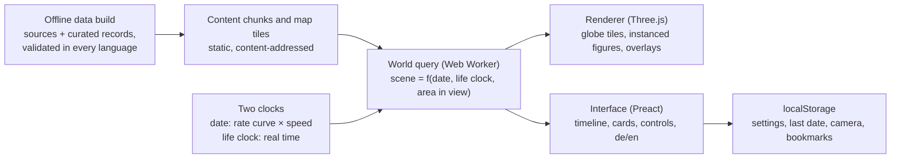

# Miniworld spec: a living globe of world history

## 1. Vision

Miniworld is a passive, historically accurate diorama of human history on a 3D globe, made for exploring history together with a child. You do not play it; you watch it, travel through time and fly to wherever something is happening. Miniature people live era-typical lives on accurate continents, from the last ice age to the present day.

The experience is closer to a living museum model than a game. A parent and child scrub to 79 n. Chr., fly to the Bay of Naples, watch Vesuvius bury Pompeii, then jump to Rome and see the Colosseum being finished a year later.

Principles that decide every design question:

1. **Accurate first.** Where, when and what comes from historical data. Procedural generation fills in only the small details that history does not record, such as where exactly a hut stands.
2. **Fully passive.** The viewer controls the camera and time, and can tap things to learn about them. Nothing the viewer does changes history.
3. **Legible at a glance.** A child should be able to tell farmers from soldiers, Romans from Han Chinese, and peace from war just by looking.
4. **The whole world.** History happens on every continent at once. The globe shows that the Han dynasty and the Roman Empire existed at the same time.
5. **Deterministic.** The same date always shows the same world, so you can return to a moment and find it exactly as you left it.
6. **Bilingual from the start.** The app ships in German and English, and every text the viewer reads, including all historical content, is localised. This spec is written in English and quotes German UI labels where they are defined.
7. **Desktop and phone.** Everything works in a desktop browser and on a phone.

## 2. Time model

History plays at a varying rate: the deep past rushes by because little visibly changes, and time slows as events grow denser towards today. The little people always move at a natural, watchable pace. These are two different clocks, and keeping them apart is what makes the diorama both accurate and pleasant to watch.

### 2.1 Historical clock

The historical date decides everything that is true about the world: which cultures live where, how many people there are, what buildings stand, which borders exist and which events are under way. At normal speed it advances along a base rate curve that is fast in the deep past and slow in recent centuries. The curve is smooth, so the rate never jumps, and it is tuned by hand against how many events fall in each period. Proposed starting curve:

| Period | Base rate | Watching time at normal speed |
| --- | --- | --- |
| 70.000 to 10.000 v. Chr. | about 2,000 years per minute | about 30 min |
| 10.000 to 3000 v. Chr. | about 200 years per minute | about 35 min |
| 3000 to 500 v. Chr. | about 50 years per minute | about 50 min |
| 500 v. Chr. to 1500 n. Chr. | about 20 years per minute | about 100 min |
| 1500 to 1800 | about 10 years per minute | about 30 min |
| 1800 to 1900 | about 5 years per minute | about 20 min |
| 1900 to today | about 2 years per minute | about 60 min |

The whole of history takes about five and a half hours at normal speed, and about half of that is the last 2,500 years.

### 2.2 Speed and pausing

- Speed multipliers apply on top of the curve: ×¼, ×½, ×1, ×2, ×4 and ×16. The UI shows the resulting rate, for example "≈ 20 Jahre/Min".
- *Geschichte anhalten* (pause history): the date stands still, but people keep doing what people of that era and place do. This is the mode for watching a moment closely, such as a day in Rome in 100 n. Chr.
- *Alles anhalten* (freeze everything): the date and every figure freeze mid-step, like a photograph, so you can look around and point things out.
- Scrubbing: drag the timeline to any date; the world updates live.

### 2.3 Life clock

Everyday activity runs on its own clock in real time, independent of the historical rate and speed multiplier. It decides what each figure is doing right now: which task it picks next (every 10 to 30 real seconds), where it walks and which animation plays. It keeps running when history is paused and stops only when everything is frozen. Because the historical date sets the era and the life clock sets the moment, people never race around at fast historical rates and never stand idle when history stops.

### 2.4 People morph instead of dying of age

Each ordinary figure is a persistent individual who stays on screen across centuries. When an era changes in its region, figures gradually take on the roles, clothes and tools of the next era over a transition window of decades, so a hunter becomes a herder, then a farmer, then a bronze smith. Figures are only lost to war, famine, plague and disasters, matching the historical record for that place and time. When the real population grows, new figures appear from houses and settlements. One figure stands for many real people, and the ratio grows as you zoom out.

### 2.5 Range and start

The timeline runs from about 70.000 v. Chr. (modern humans leaving Africa) to the present. The app opens at 50.000 v. Chr., in the middle of the last ice age, with modern humans already spreading out of Africa.

### 2.6 Day and night

A gentle day and night cycle runs on the life clock, about 4 real minutes per day, with a setting to keep it always day. Seasons are not cycled, since a year passes in seconds at most rates; regional climate and long-term changes such as the ice age are shown instead.

## 3. The globe

The world is the real Earth with accurate continents, coasts, mountains and rivers, but everything people make is drawn as a miniature far larger than true scale. A true-scale person would be invisible from any height that shows a landscape, so the globe uses two scales at once.

- **Geography at true proportions.** Landmasses, coastlines, rivers and lakes sit in their real places. Elevation is exaggerated (about 10 to 20 times) so mountains and valleys read clearly when you are close.
- **People and buildings as miniatures.** Figures, houses, ships and monuments are scaled up by a fixed factor so a village reads clearly from a low camera. A settlement is drawn as a representative cluster: a Neolithic village is 5 to 15 huts, Rome at its height a few hundred buildings around its real landmarks. Cluster size follows the real population.
- **Camera range.** You zoom continuously from a view of the whole planet down to a close-up where a dozen figures fill the screen. Close to the ground the curved horizon gives the Populous: The Beginning look naturally.

**The planet changes over time.** The globe follows known long-term changes, which are some of the best teaching moments:

- Sea level was about 120 m lower at the height of the last ice age, roughly 20,000 years ago. Land bridges such as Beringia (Siberia to Alaska), Doggerland (Britain to the continent) and Sundaland (much of Indonesia joined to Asia) appear and drown as the sea rises. Because the elevation data includes the sea floor, the coastline for any date is computed from a sea-level curve.
- Ice sheets cover northern North America and Scandinavia at the glacial maximum and retreat over the following millennia.
- The Sahara is green with lakes and grassland between roughly 9000 and 3500 v. Chr.
- Later and smaller changes, such as land reclaimed in the Netherlands or large reservoirs, are added only when they matter to a story.

Geography data comes from public datasets that are preprocessed offline into static map tiles: global elevation including the sea floor (for example NOAA ETOPO) and coastlines, rivers and lakes (for example Natural Earth). Licenses are confirmed before use.

## 4. Representing history

History enters the app as a curated database of dated, located records; everything you see is generated from it. There is no economy or production chain underneath: figures simply do what people of that culture and era typically did.

| Data layer | What one record holds | Candidate sources (licenses to confirm) |
| --- | --- | --- |
| Culture regions | An area, a date range and a culture profile, such as "Römisch, Kaiserzeit" or "Han-China" | Curated by hand from standard histories |
| Culture profiles | Architecture set, clothing, tools, vehicles, crops and animals, and an activity mix (farming, fishing, crafts, trade, worship, soldiering) | Curated; the main art cost |
| Population | People per area over time, which sets how many figures appear | HYDE (History Database of the Global Environment) |
| Settlements | Localised name, coordinates, founding date, population over time, landmarks with build dates | Urban history datasets, Wikidata |
| Polities | Borders at snapshot dates, localised name, colour, capital | historical-basemaps (open GeoJSON of world borders), Wikidata |
| Routes | Trade routes, migrations and voyages with date ranges | Curated |
| Events | Date or range, place, type, localised title and text, how it is shown | Curated; see [ereignisse.md](ereignisse.md) |
| Famous people | Life dates, places over their life, role, look, localised text | Wikidata plus curation; see [persoenlichkeiten.md](persoenlichkeiten.md) |

**Culture profiles carry the look.** A profile is what makes Egyptian farmers on the Nile look different from Maya farmers in Yucatán: different houses, clothes, crops and tools doing a similar job. A solid first version needs about 40 profiles; later versions add more and split them by period.

**Accuracy policy.**

- Every record names its source. Uncertain dates are labelled as approximate ("um 2560 v. Chr.").
- Procedural details may fill gaps but never contradict the data: no buildings before their date, no crops on the wrong continent, no iron tools in the Bronze Age.
- The view is global, not only European. Each era lane on the timeline covers several regions of the world.
- Disputed topics (for example dates of early dynasties) show the mainstream view and say that it is debated.

**Child-appropriate presentation.** The audience is an 11-year-old with a parent. Nothing is bloody, but nothing is softened into something it was not: wars, conquest, slavery, colonial violence, genocide and the Holocaust are named and explained correctly in the cards. Fallen figures sink down and fade out, with no blood. Famine shows as bare fields, thin herds and fewer people; plague as empty streets and closed doors. Card texts are written for a reader of about 11 to 12, with a "Mehr erfahren" section for more detail.

## 5. How events appear in the world

Every event has a type, and each type has one reusable way of showing itself on the globe, so adding an event is mostly data. The event list lives in [ereignisse.md](ereignisse.md); this table defines the types.

| Event type | How it looks in the world | Example |
| --- | --- | --- |
| Construction | A building site with scaffolding and workers, growing over the real construction years | Pyramids of Giza, Great Wall, Colosseum |
| Founding | Settlers arrive, clear land and raise the first buildings | Rome, Constantinople, Tenochtitlan |
| Destruction | Fire, collapse or abandonment; the site becomes ruins that remain visible | Sack of Rome 410, Carthage 146 v. Chr. |
| Battle | Two armies in era-typical gear meet, clash briefly and one withdraws | Cannae, Hastings, Waterloo |
| War (range) | Armies march along routes, front lines on the border overlay, smoke over towns | Punic Wars, Thirty Years' War, World Wars |
| Migration | A stream of families with animals and carts crossing the map | Out of Africa, Bantu expansion, Migration Period |
| Voyage | Ships trace the real route with a fading wake line | Zheng He, Columbus, Magellan |
| Trade route | Caravans or ships moving steadily along the route for its whole active period | Silk Road, trans-Saharan trade |
| Epidemic or famine | Figures thin out, fields go bare, streets empty; numbers follow the record | Black Death, Irish famine |
| Natural disaster | Eruption, earthquake, flood or tsunami at the real place | Vesuvius 79, Lisbon 1755 |
| Invention or idea | A glowing workshop scene where it happened, then the new thing spreads to neighbouring regions | Writing, printing press, steam engine |
| Political change | Borders, flags and capital markers change on the overlay; a crowd gathers at the capital | Coronation of Charlemagne, French Revolution |
| Religion | A temple, church or mosque is built; its style spreads along routes | Spread of Buddhism, Christianity, Islam |

**Finding events.** Events in progress near the camera show a small floating marker with an icon and the title. Events far away appear on the timeline and in a list "Jetzt in der Welt" (now in the world). Double-clicking any event flies the camera there and, if needed, moves time to its start.

## 6. People

The world has two kinds of figures: ordinary people, who carry the everyday life of an era, and famous people, who carry its story.

**Ordinary people.** Each figure has a stable identity, a home settlement and a role from its culture profile, such as Jäger, Bäuerin, Töpfer, Schmied, Händlerin, Priester, Soldat or Fischer. Roles are weighted by the profile's activity mix, so a Roman city has more craftspeople and traders than a Neolithic village. Figures do not die of age; they morph into the next era's roles (section 2.4). Tapping a figure shows a short card: their role, what they are doing and why it matters ("Sie mahlt Getreide zu Mehl. Brot war das wichtigste Essen im alten Ägypten.").

**Activities.** Each role has a few era-typical routines made of short animated actions: walk to a place, work there, carry something, rest, talk. Examples: gatherers search bushes and return to camp; Egyptian farmers work shaduf and fields along the Nile; Roman legionaries march on roads and build camps; medieval monks copy books; industrial workers walk to factories. The goal is that a child can watch one place for a minute and describe what people did there.

**Famous people.** Famous historical figures appear as unique, recognisable figures in the right place for the period they were active, and follow their real movements: Caesar campaigns in Gaul, Marco Polo travels to China, Zheng He sails with his fleet. Their card tells who they were, what they did and why they are remembered, in a sentence or two a child can follow. When their life ends they fade out in a soft light. A searchable list "Persönlichkeiten" lets you jump to any of them. The first list is in [persoenlichkeiten.md](persoenlichkeiten.md).

## 7. Interface

The screen is the globe with a timeline along the bottom; everything else stays out of the way until asked for.

### 7.1 Timeline (Zeitleiste)

- A top lane "Welt" shows global eras as coloured ranges (Altsteinzeit, Jungsteinzeit, Bronzezeit and so on). Below it, one lane per world region shows that region's eras and empires as coloured ranges: Europa und Mittelmeer, Naher Osten und Nordafrika, Afrika südlich der Sahara, Südasien, Ostasien, Amerika, Ozeanien. Ranges are defined in [epochen.md](epochen.md).
- Events sit on the timeline as small icons by type. Hovering or tapping shows the title and date; double-clicking (double-tapping on phones) flies the camera to the place and moves time there.
- The timeline zooms from the whole of history down to single years. Its axis follows the same rate curve as the clock, so each period is as wide as its watching time. A toggle "Echte Zeitachse" switches to the true linear scale, where all of written history is a thin sliver at the end.
- Dragging the playhead scrubs through time. Controls: Geschichte anhalten, Alles anhalten, and speed from ×¼ to ×16.

### 7.2 Overlays (Ebenen)

- *Grenzen*: coloured, labelled borders of states and empires, available from about 3000 v. Chr. where data exists. Borders crossfade between snapshot dates instead of jumping.
- *Ortsnamen*: names of settlements, rivers, seas and regions as they were called at that time where known, with the modern name in the viewer's language in brackets.
- *Routen*: trade routes, migrations and voyages as animated lines.

### 7.3 Info cards

Tapping a figure, building, event or famous person opens a short card in plain language suitable for a child, with an optional "Mehr erfahren" section for adults. Cards never pause time unless the viewer pauses.

### 7.4 Localisation (Sprachen)

German and English ship from the first milestone, and adding a language needs translations but no code changes.

- Every UI string lives in a per-language message file with plural rules; no text is hard-coded in components or painted into textures.
- Every content record (events, people, cultures, places, cards) carries its text per language, for example a title in `de` and `en`. The data build fails when a supported language is missing.
- Place names have forms per language and per period: Köln and Cologne; Byzanz, Konstantinopel and Istanbul.
- Dates and numbers are formatted per language: "753 v. Chr." and "753 BC", "1.000" and "1,000".
- The language follows the browser, falls back to German, and can be switched in the settings without reloading. Layouts leave room for German labels, which often run about a third longer than English.

### 7.5 Desktop and phone

Desktop: drag to rotate, scroll to zoom, right-drag to tilt, space to pause history, shift and space to freeze everything. Phone: one finger rotates, pinch zooms, two fingers tilt. On phones the timeline shows only the Welt lane plus the lane for the region in view, expandable to all lanes, and info cards open as bottom sheets. Both portrait and landscape work.

### 7.6 What is saved

With no simulation state to keep, browser local storage holds only small things: settings, the last date and camera position, and bookmarks ("Lesezeichen") of favourite moments and places.

## 8. Visual style

The target is the look of Warcraft III: stylised, chunky proportions, hand-painted textures and warm lighting, with more geometry than the flat low-poly Populous models. Figures have slightly large heads and hands so roles and tools read from a distance.

| Asset | Detail at the closest zoom | Notes |
| --- | --- | --- |
| Figure | About 500 to 1,000 triangles, one painted texture | One shared skeleton for all humans; clothing, headgear and tools swap per culture profile |
| Building | About 1,000 to 4,000 triangles | Modular kits per architecture style so a city can be assembled from parts |
| Landmark | Up to about 20,000 triangles | Pyramids, Colosseum, Hagia Sophia and other unique buildings |
| Animals, ships, vehicles | 300 to 3,000 triangles | Reused across cultures with texture variants |
| Terrain | Splat-mapped painted tiles (grass, soil, sand, rock, snow, fields) | Fields, roads and town ground painted from data |

Every asset has two or three lower levels of detail, and at globe zoom figures become small coloured marks. Quality tiers (Hoch, Mittel, Niedrig) are picked automatically from the device and can be changed in the settings; phones default to Niedrig or Mittel.

**Asset production.** Assets are generated rather than bought or commissioned, and Yang reviews every generated asset before it is used. The modular approach (one skeleton, culture-specific parts, building kits) keeps the roughly 40 culture profiles affordable. Each asset carries a review status (`generated`, `approved`, `rejected`) in the asset manifest, and the app only ships approved assets.

## 9. Architecture

The world on screen is a pure function of two clocks: the historical date decides the state of the world, and the life clock decides what each figure is doing at this moment. Given the same data, date and life-clock time, the app always computes the same world, without simulating forward from the beginning. That one decision delivers determinism, instant scrubbing to any year and tiny saves at the same time.

**Offline data build.** Node scripts turn source datasets and hand-curated records (events, people, cultures, settlements) into validated content chunks and globe map tiles (section 10). Validation fails the build when a record lacks a date, a location, a source or its text in any supported language, or when references point nowhere.

**World query (Web Worker).** For the current date and the area in view, the worker computes a scene: which culture profiles apply, which settlements and buildings stand, which figures exist with their role, task and position, which events are under way, and which borders apply.

- Every random-looking choice comes from a seeded hash of stable inputs, such as figure id plus time slot. There is no `Math.random` and no wall clock in the world state.
- A figure's task comes from a hash of its id and the current life-clock slot (10 to 30 seconds); its position is interpolated within the slot. Its role at a date comes from its culture profile, with a per-figure offset inside the transition window, which is what makes eras morph gradually.
- War, famine, epidemic and disaster events remove a share of figures in their area that matches the record; which figures are lost is decided by hash, so it is the same every time.
- Dates use whole-day integers, never floating-point years, so results match on every device.

**Renderer (main thread).** Three.js on WebGL2, with WebGPU as a later option. Globe terrain is a cube-sphere quadtree that streams tiles as you zoom. Figures are drawn with instancing and baked animation textures, so thousands of animated figures cost little. Buildings are instanced from modular kits; overlays are drawn as lines and labels on the globe.

**Interface.** Preact for panels and cards, and a canvas-drawn timeline for smooth zooming with many events.

**Storage and offline use.** localStorage holds settings, the last date and camera, and bookmarks. Content chunks and tiles are cached by a service worker, so places and periods already visited also work without a connection.

**Why Three.js and not Unity.** The cost is in drawing thousands of small figures, which depends on instancing, level of detail and GPU animation, not on the engine. Three.js does these well and keeps the app small, quick to start and plain web code, which suits streamed content, the DOM interface, localisation and offline caching. A Unity web build is typically tens of megabytes before the first frame and memory-hungry on phone browsers. Babylon.js is the fallback if more built-in engine features are needed.

**Performance budget.**

| Device class | Reference | Target |
| --- | --- | --- |
| Average desktop or laptop | 4 to 5 year old laptop with integrated graphics | 60 fps, never below 30 fps |
| Average phone | 3 year old mid-range phone | 30 fps or better |

- Draw calls per frame: at most about 300 on desktop and 150 on phones; figures, buildings and vegetation are always instanced.
- Visible animated figures: about 5,000 on desktop and 1,500 on phones before LOD swaps them for simpler marks.
- World query in the worker: under 8 ms per update, so the main thread only renders.
- Quality tiers (section 8) are chosen from a short benchmark on first start; dynamic resolution lowers the render scale when frame time rises.
- A stress scene (thousands of figures over a dense city at close zoom) runs in milestone 1 to prove these targets before content work starts, and stays in the test suite as a performance check.

**Tests.** Golden snapshot tests compute the scene for a list of fixed dates and places and compare it to a stored result; any difference must be intended. Data validation runs in the same suite, and browser tests check the timeline and the camera fly-to on desktop and phone sizes.

## 10. Content delivery

Content will grow to many thousands of records, hundreds of models and a global terrain set, so the app never downloads it all. It loads a small index up front and streams everything else by place, time and language as the viewer moves.

**What loads at startup.** A versioned manifest plus a light index per language: era ranges for the timeline, every event's id, date, type, position and title, and the list of famous people with life dates. This is enough to draw the full timeline and search, and it stays small because it holds no long texts, borders or geometry. Target: the first view of the globe at 50.000 v. Chr. needs at most about 3 MB on a phone.

**Chunks.** Everything else is split into chunks keyed by three things:

- **Place:** the same cube-sphere quadtree tile keys the terrain uses, at a level chosen per content type (borders coarser, settlements finer).
- **Time:** windows aligned to the rate curve, so each window covers a similar amount of watching time (thousands of years in the deep past, a few years in the 20th century).
- **Language:** text lives in separate per-language chunks, so a viewer only downloads one language.

Card texts and "Mehr erfahren" sections load on demand when a card opens. Models and textures are bundled per culture profile and load when that culture is near the camera and the current time window.

**Formats.** Chunks start as Brotli-compressed JSON and move to a binary format only if size or parse time demands it. Models are glTF with meshopt compression and KTX2 textures; terrain uses compressed heightmap tiles per quadtree level.

**Caching.** Chunk file names contain a hash of their content, so they are cached forever and a new release only downloads what changed. The manifest maps chunk keys to hashes. A service worker keeps visited chunks for offline use and evicts the least recently used when storage runs short.

**Prefetching.** The app prefetches the tiles around the camera and the next time windows in the direction of playback, scaled to the current rate. During scrubbing it loads only the light layers (borders, settlements, event markers) and fills in figures and models when the playhead stops.

**Determinism is unaffected by loading.** The world query computes the same scene whether or not a chunk has arrived. Missing models show a neutral placeholder and missing text shows a loading state; nothing about the world's state depends on network timing.

**Hosting.** All content is static files, so any static host or CDN can serve it; there is no content server to run.

## 11. Development environment

Development uses [devenv](https://devenv.sh) so every machine and every Claude session gets the same toolchain.

- `devenv.nix` pins Node and the other tools the project needs.
- `devenv up` starts the dev server at http://localhost:8800, serving the app with hot reload and the locally built content chunks under the same origin.
- Scripts for the data build, tests and asset pipeline run inside `devenv shell`.

## 12. Development process

The spec comes first, always: every change to behaviour, content or data format is written into this folder before any code is changed, in the same pull request or an earlier one. The rule is recorded in [CLAUDE.md](../../CLAUDE.md).

## 13. Milestones

Each milestone ends with something to show an 11-year-old. The first three prove the hardest technical ideas (the globe, the time model, morphing figures) on a small slice of history before content is added era by era.

1. **Globe and time.** devenv setup, accurate Earth with painted terrain, camera from orbit to ground on desktop and phone, German and English UI shell with a language switch, timeline with speeds, both pause modes and scrubbing, settings and bookmarks in local storage, chunked content loading, and the performance stress scene.
2. **First people.** Deterministic world query, Paleolithic hunter-gatherers in Africa and Europe from 50.000 v. Chr., the Out of Africa migration, sea level and ice sheets changing with the date, golden snapshot tests.
3. **Neolithic.** Figures morph from foragers to farmers in the Fertile Crescent and spread into Europe; first villages; first events on the timeline with fly-to.
4. **Early civilisations.** Egypt, Mesopotamia, the Indus Valley and Shang China; the border overlay; famous people with cards.
5. **Classical world.** Greece, Persia, the stages of Rome, Maurya India, Qin and Han China; trade routes such as the Silk Road.
6. **Late antiquity and Middle Ages.** The Migration Period and fall of the Western Roman Empire, Byzantium, the caliphates, Tang and Song China, the Mongols, Mali, the Maya.
7. **Early modern.** Renaissance, voyages of discovery, colonialism, the Aztec and Inca empires, Ming and Qing China, the Mughal Empire, the Ottomans.
8. **Modern age.** Industrialisation, nation states, the world wars, decolonisation, the Cold War, the present.
9. **Polish.** Offline support, performance on older phones, more culture profiles and events.

**Later: guided tours (Führungen).** Passive camera journeys through a story, such as "Ein Tag in Rom" or "Die Reise des Marco Polo", built on the same timeline and fly-to.
