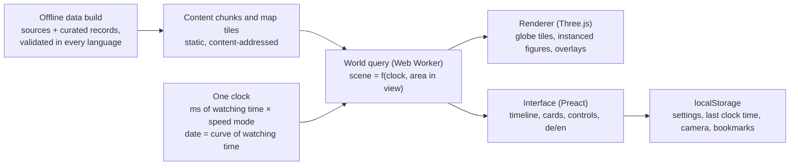

# Miniworld spec: a living globe of world history

## 1. Vision

Miniworld is a passive, historically accurate diorama of human history on a 3D globe, made for exploring history together with a child. You do not play it; you watch it, travel through time and fly to wherever something is happening. Miniature people live era-typical lives on accurate continents, from the last ice age to the end of the Soviet Union in 1991.

The experience is closer to a living museum model than a game. A parent and child scrub to 79 CE, fly to the Bay of Naples, watch Vesuvius bury Pompeii, then jump to Rome and see the Colosseum being finished a year later.

Principles that decide every design question:

1. **Accurate first.** Where, when and what comes from historical data. Procedural generation fills in only the small details that history does not record, such as where exactly a hut stands.
2. **Fully passive.** The viewer controls the camera and time, and can tap things to learn about them. Nothing the viewer does changes history.
3. **Legible at a glance.** A child should be able to tell farmers from soldiers, Romans from Han Chinese, and peace from war just by looking.
4. **The whole world.** History happens on every continent at once. The globe shows that the Han dynasty and the Roman Empire existed at the same time.
5. **Deterministic.** The same date always shows the same world, so you can return to a moment and find it exactly as you left it.
6. **Localised from the start.** English and German are developed together as equal localisations, and every text the viewer reads, including all historical content, exists in both. This spec is written in English; UI labels quoted here are the English strings, and their German counterparts live in the localisation files.
7. **Desktop and phone.** Everything works in a desktop browser and on a phone.

## 2. Time model

Two kinds of time, defined by Yang on 2026-10-19:

- **Watching time** is the rate at which everything on screen moves: people at work, animals grazing, water, clouds and every diorama beat. It runs at real time at regular speed, and the speed modes speed it up or slow it down (section 2.2). It is counted in milliseconds from the start of the timeline; this count is **the clock**.
- **History time** is the date: the historical day the world shows, with everything true about it (which cultures live where, how many people there are, what buildings stand, which borders exist and which events are under way). It follows from watching time by a fixed curve that runs fast through the deep past and slowly through written history (section 2.1).

The **timeline** shows the historical events, but it is laid out linearly in watching time: a minute of watching is the same width anywhere on it, so the deep past, which passes quickly, takes little room and the busy recent centuries take much (section 7.1).

Everything on screen is a function of the clock alone, so nothing depends on how long someone has been watching: every diorama is fully scripted, and at a given moment of the timeline it shows the same scene, in the same place, at the same beat, every time and for everyone.

### 2.1 Watching time and history time

- **The curve** (decided by Yang on 2026-10-19, replacing the even rate of 25 years per minute of 2026-10-18). History's rate, in years per minute of watching at regular speed, is the age before the end of the timeline divided by a constant, so each factor of ten of the past gets about the same watching time; nudged by a rough estimate of how much happens in each stretch, from the era boundaries we have (busier stretches a little slower, by the square root of the density, heavily smoothed, and within a factor of about 1.6 either way), so it is not meant to move as content is added; and **never slower than one year per minute**. The constant is chosen so that the whole timeline, from 70,000 BCE to 26 December 1991, takes **exactly 24 hours** at regular speed.
- The curve is generated once by `node scripts/time-curve.ts` into `app/src/time/curve.ts`: 513 knots, evenly spaced in watching time, each a whole number of milliseconds and a whole day, the last at exactly 86,400,000 ms on the last day of the timeline. Between knots the date runs linearly in exact integer arithmetic, so the same clock time is always the same date, and the clock time at which a day begins is the smallest that gives that day. The data build fails when the content cutoff no longer matches the curve's end.

| Date | History's rate at regular speed |
| --- | --- |
| 70,000 BCE | about 560 years per minute |
| 20,000 BCE | about 170 |
| 10,000 BCE | about 95 |
| 3000 BCE | about 22 |
| 1 CE | about 6.5 |
| 1000 | about 3.3 |
| 1500 | about 1.9 |
| from about 1800 | 1 |

| Period | Watching time at regular speed |
| --- | --- |
| 70,000 to 50,000 BCE | 42 min |
| 50,000 to 10,000 BCE | 3 h 8 min |
| 10,000 to 3000 BCE | 2 h 23 min |
| 3000 to 500 BCE | 3 h 6 min |
| 500 BCE to 1500 | 8 h 1 min |
| 1500 to 1800 | 3 h 29 min |
| 1800 to 1900 | 1 h 40 min |
| 1900 to 1991 | 1 h 32 min |
| **The whole timeline** | **24 h** |

- In the deep past a millisecond of watching spans a few days, so there not every day has a clock time of its own; from the time a day lasts at least a millisecond, each has one exactly.
- People and animals move at their natural pace in watching time everywhere. What changes with the curve is how much history passes while they do: in the deep past the camps of the tree of humankind come and go about fourteen times as quickly in watching time as around 3000 BCE, because their history is the same ([humankind.md](humankind.md) section 4).

### 2.2 Speed and pausing

- Four speed modes instead of a slider (decided by Yang on 2026-10-18 and 2026-10-19): **slow** (×1/10), **regular** (×1), **fast** (×10) and **fastest** (×100). The mode only changes how fast the clock runs: at a faster speed watching time runs faster, so the figures move faster too, like a film played fast, and history passes faster in proportion; in slow mode they move in slow motion. The rate shown beside the date is history's rate at the current date times the mode's factor.
- Zooming does not change the speed (the earlier slowdown when zoomed in was removed by Yang on 2026-10-18).
- *Pause*: the clock stops, so the date and every figure stop mid-step, like a photograph, so you can look around and point things out. There is no mode in which the date stands still while people carry on.
- Scrubbing: drag the timeline to any point; the clock jumps there and the world, including every diorama, shows exactly what it shows at that point when played.

### 2.3 One clock

Earlier versions ran everyday activity on a second, separate clock. There is one clock, watching time: figures and animations run on it, and the date follows from it by the curve of section 2.1. Which task a figure picks next (every 10 to 30 seconds of watching), where it walks and which animation plays are a function of the clock, so scrubbing back to a moment replays it exactly.

### 2.4 People morph instead of dying of age

Each ordinary figure is a persistent individual who stays on screen across centuries. When an era changes in its region, figures gradually take on the roles, clothes and tools of the next era over a transition window of decades, so a hunter becomes a herder, then a farmer, then a bronze smith. Figures are only lost to war, famine, plague and disasters, matching the historical record for that place and time. When the real population grows, new figures step out of the lodgings people live in: tents and huts at first, later houses, forts and palaces. Every ordinary figure has a parent figure it came out of, so all of them form one family tree that goes back to a single first person at Lake Turkana in Kenya at the start of the timeline (asked for by Yang on 2026-10-18). The tree is computed by the data build from the historical data, and the app only looks it up; the design is in [humankind.md](humankind.md). One figure stands for many real people, and the ratio grows as you zoom out; the first person stands for the first people of Africa.

### 2.5 Range and start

The timeline runs from 70,000 BCE to 26 December 1991, the day the Soviet Union was dissolved, which ends the Cold War (decided by Yang on 2026-10-17). That date is the content cutoff, fixed for every build: no event, war, border, building or era on the globe or the timeline goes past it, and an event or war that began before it but mostly happened after it is left out. A card may say in a sentence what happened next, such as Nelson Mandela becoming president in 1994, but the world itself stops at the cutoff. The app opens at the start of the timeline, 70,000 BCE, on the first person at Lake Turkana in Kenya, who builds a hut and hunts; her family fills Africa by about 62,000 BCE and leaves it from about 60,000 BCE ([humankind.md](humankind.md#7-changes-to-the-rest-of-the-spec) section 7; decided by Yang on 2026-10-18).

### 2.6 Lighting

There is no day and night cycle: the globe is always evenly lit, like a model under studio lights (decided by Yang on 2026-10-17). Seasons are not cycled either, since a year passes in seconds at most rates; regional climate and long-term changes such as the ice age are shown instead.

## 3. The globe

The world is the real Earth with accurate continents, coasts, mountains and rivers, but everything people make is drawn as a miniature far larger than true scale. A true-scale person would be invisible from any height that shows a landscape, so the globe uses two scales at once.

- **Geography at true proportions.** Landmasses, coastlines, rivers and lakes sit in their real places (the history lens below changes their drawn size, not their order or shape). Elevation is exaggerated 100 times (decided by Yang on 2026-10-17, tunable) so mountains and valleys read clearly, even from orbit.
- **People and buildings as miniatures.** Figures, houses, ships and monuments are scaled up by a fixed factor so a village reads clearly from a low camera. A settlement is drawn as a representative cluster: a Neolithic village is 5 to 15 huts, Rome at its height a few hundred buildings around its real landmarks. Cluster size follows the real population.
- **History lens.** By default the globe draws regions with many events, such as Europe and the Nile valley, larger and empty regions such as the open oceans smaller, so the busy places have room. Shapes and neighbours stay recognisable, everything stays in its real place relative to the land, and a slider sets its strength from 0% (the real proportions) to 200%. The lens is applied only when the world is drawn, never in the world itself; the design is in [history-lens.md](history-lens.md).
- **Camera range.** You zoom continuously from a view of the whole planet down to a close-up where a dozen figures fill the screen. Close to the ground the curved horizon gives the Populous: The Beginning look naturally.

**The planet changes over time.** The globe follows known long-term changes, which are some of the best teaching moments:

- Sea level was about 120 m lower at the height of the last ice age, roughly 20,000 years ago. Land bridges such as Beringia (Siberia to Alaska), Doggerland (Britain to the continent) and Sundaland (much of Indonesia joined to Asia) appear and drown as the sea rises. Because the elevation data includes the sea floor, the coastline for any date is computed from a sea-level curve.
- Ice sheets cover northern North America and Scandinavia at the glacial maximum and retreat over the following millennia.
- The Sahara is green with lakes and grassland between roughly 9000 and 3500 BCE.
- Later and smaller changes, such as land reclaimed in the Netherlands or large reservoirs, are added only when they matter to a story.

Geography data comes from public datasets that are preprocessed offline into static map tiles: global elevation including the sea floor (for example NOAA ETOPO) and coastlines, rivers and lakes (for example Natural Earth). Every source must meet the data licence policy in section 13, and a copy of the data used is kept in the repository.

## 4. Representing history

History enters the app as a curated database of dated, located records; everything you see is generated from it. There is no economy or production chain underneath: figures simply do what people of that culture and era typically did.

| Data layer | What one record holds | Candidate sources (licenses to confirm) |
| --- | --- | --- |
| Culture regions | An area, a date range and a culture profile, such as "Roman, Imperial period" or "Han China" | Curated by hand from standard histories |
| Culture profiles | Architecture set, clothing, tools, vehicles, crops and animals, and an activity mix (farming, fishing, crafts, trade, worship, soldiering) | Curated; the main art cost |
| Population | How many figures live where: a hand-set density per culture area ([milestone-2.md](milestone-2.md#3-where-people-live) section 3) and a size class per settlement; no population data goes into the world (decided by Yang on 2026-10-18) | Curated; published population estimates are used only to check the tree of humankind ([humankind.md](humankind.md#61-checking-against-population-estimates) section 6.1) |
| Settlements | Localised name, coordinates, founding date, population over time, landmarks with build dates | Urban history datasets, Wikidata |
| Polities | Borders at snapshot dates, localised name, colour, capital | historical-basemaps (open GeoJSON of world borders; GPL-3.0, so it needs Yang's decision under section 13), Wikidata (CC0) |
| Routes | Trade routes, migrations and voyages with date ranges | Curated |
| Landmarks | Unique buildings and sites with construction stages, later changes and ruins by date | Curated, with an approved model each |
| Events | Start and end date, optional peak, place with a point to fly to ([content-format.md](content-format.md#4-place) section 4), type, localised title and text, how it is shown over its span; wars also name their sides, battles their war, and both the famous people who took part | Curated; see [events.md](events.md) and [wars.md](wars.md) |
| Famous people | Life dates, places over their life, stable id, role, category, look, localised text | Wikidata plus curation; see [people.md](people.md) |

Every record is stored in the format of [content-format.md](content-format.md): one Markdown file per record with structured fields and English and German text, validated by the data build, with chronological indexes generated from the records.

**Culture profiles carry the look.** A profile is what makes Egyptian farmers on the Nile look different from Maya farmers in Yucatán: different houses, clothes, crops and tools doing a similar job. A solid first version needs about 40 profiles; later versions add more and split them by period.

**Accuracy policy.**

- Every record names its source. Uncertain dates are labelled as approximate ("c. 2560 BCE").
- Procedural details may fill gaps but never contradict the data: no buildings before their date, no crops on the wrong continent, no iron tools in the Bronze Age.
- The view is global, not only European. Each era lane on the timeline covers several regions of the world.
- Disputed topics (for example dates of early dynasties) show the mainstream view and say that it is debated.
- Event density: wherever a civilisation keeps dated records, its events leave no gap longer than 20 years, so there is always something recent happening there. The headline events are in [events.md](events.md) and the dense regional lists in [events/](events/). Where the record itself has a longer gap, the regional list names the gap instead of inventing events.

**Child-appropriate presentation.** The audience is an 11-year-old with a parent. Nothing is bloody, but nothing is softened into something it was not: wars, conquest, slavery, colonial violence, genocide and the Holocaust are named and explained correctly in the cards. Fallen figures sink down and fade out, with no blood. Famine shows as bare fields, thin herds and fewer people; plague as empty streets and closed doors. Card texts are written for a reader of about 11 to 12, with a "Learn more" section for more detail.

## 5. How events appear in the world

Every event has a type, and each type has one reusable way of showing itself on the globe, so adding an event is mostly data. The event list lives in [events.md](events.md), and wars and battles in [wars.md](wars.md); this table defines the types.

| Event type | How it looks in the world | Example |
| --- | --- | --- |
| Construction | A building site with scaffolding and workers, growing over the real construction years | Pyramids of Giza, Great Wall, Colosseum |
| Founding | Settlers arrive, clear land and raise the first buildings | Rome, Constantinople, Tenochtitlan |
| Destruction | Fire, collapse or abandonment; the site becomes ruins that remain visible | Sack of Rome 410, Carthage 146 BCE |
| Battle | Two armies in era-typical gear meet, clash briefly and one withdraws | Cannae, Hastings, Waterloo |
| War (range) | Armies march along routes, front lines on the border overlay, smoke over towns | Punic Wars, Thirty Years' War, World Wars |
| Migration | A stream of families with animals and carts crossing the map | Out of Africa, Bantu expansion, Migration Period |
| Voyage | Ships trace the real route with a fading wake line | Zheng He, Columbus, Magellan |
| Trade route | Caravans or ships moving steadily along the route for its whole active period | Silk Road, trans-Saharan trade |
| Epidemic or famine | Figures thin out, fields go bare, streets empty; numbers follow the record | Black Death, Irish famine |
| Natural disaster | Eruption, earthquake, flood, tsunami, storm or impact at the real place; a climate shift (ice age, cold spell, drought, desert spreading) shows as ice, rivers, fields and terrain changing over its real span | Vesuvius 79, Lisbon 1755, Little Ice Age |
| Invention or idea | A glowing workshop scene where it happened, then the new thing spreads to neighbouring regions | Writing, printing press, steam engine |
| Political change | Borders, flags and capital markers change on the overlay; a crowd gathers at the capital | Coronation of Charlemagne, French Revolution |
| Religion | A temple, church or mosque is built; its style spreads along routes | Spread of Buddhism, Christianity, Islam |

**Events take time.** Every event has a start date and an end date, which are the same for an event of a single day, and may have a peak: the day, years or phase when it is strongest. The span covers everything the globe shows, not just the headline moment: the warning signs before an eruption, the years of cold after it, the later waves of a plague, the centuries a desert takes to spread. Between start and peak the effect builds up, and between peak and end it fades, at the pace the record gives; a slow climate shift changes the land gradually over centuries, while an earthquake starts at full strength. Changes that outlast the event stay in the world after its end, such as a crater lake, a drowned coastline, ruins or a toppled statue. An event that came back in waves, such as plague or cholera, lists its waves as phases, each with its own dates and places.

**Vignettes** (removed, Yang 2026-10-22, issue 147). An engine for small staged stories with a cast, props and a script on the clock was built for the pyramids of Giza and removed unused; the scenes of the tree of humankind ([humankind.md](humankind.md)) are staged by the camps themselves. The recurring dioramas once planned are an idea list in [dioramas.md](dioramas.md).

**Finding events.** Events in progress near the camera show a small floating marker with an icon and the title. Events far away appear on the timeline and in a list "Happening now". Double-clicking any event flies the camera there and, if needed, moves time to its start.

## 6. People

The world has two kinds of figures: ordinary people, who carry the everyday life of an era, and famous people, who carry its story.

**Ordinary people.** Each figure has a stable identity, a home settlement and a role from its culture profile, such as hunter, farmer, potter, smith, trader, priest, soldier or fisher. Roles are weighted by the profile's activity mix, so a Roman city has more craftspeople and traders than a Neolithic village. Figures do not die of age; they morph into the next era's roles (section 2.4). Tapping a figure shows a short card: their role, what they are doing and why it matters ("She is grinding grain into flour. Bread was the most important food in ancient Egypt.").

**Activities.** Each role has a few era-typical routines made of short animated actions: walk to a place, work there, carry something, rest, talk. Examples: gatherers search bushes and return to camp; Egyptian farmers work shaduf and fields along the Nile; Roman legionaries march on roads and build camps; medieval monks copy books; industrial workers walk to factories. The goal is that a child can watch one place for a minute and describe what people did there.

**Famous people.** Famous historical figures appear as unique, recognisable figures in the right place for the period they were active, and follow their real movements: Caesar campaigns in Gaul, Marco Polo travels to China, Zheng He sails with his fleet. Their card tells who they were, what they did and why they are remembered, in a sentence or two a child can follow. When their life ends they fade out in a soft light. A searchable list "Famous people", which can be filtered by category (rulers, conquerors, scientists, artists and others), lets you jump to any of them. The first list is in [people.md](people.md).

## 7. Interface

The screen is the globe with a timeline along the bottom; everything else stays out of the way until asked for.

### 7.1 Timeline

- A top lane "World" shows global eras as coloured ranges (Paleolithic, Neolithic, Bronze Age and so on). Below it, one lane per world region shows that region's eras and empires as coloured ranges: Europe and Mediterranean, Middle East and North Africa, Sub-Saharan Africa, Central Asia and steppe, South Asia, East Asia, Southeast Asia, Americas, Oceania. Ranges are defined in [eras.md](eras.md).
- Events sit on the timeline as small icons by type. An event that lasts longer than it takes to watch for a moment shows as a thin bar from start to end, with its icon at the peak and its phases marked on the bar. Hovering or tapping shows the title and date; double-clicking (double-tapping on phones) flies the camera to the place and moves time there.
- The timeline zooms from the whole of history down to single years. Its axis is **linear in watching time** (section 2; decided by Yang on 2026-10-19, replacing the logarithmic axis of 2026-10-18): it shows the historical events where the clock reaches them, so the deep past, which passes quickly, takes little room and the recent centuries, where events are dense and history passes slowly, take much ([milestone-1.md](milestone-1.md#72-axis-and-zoom) section 7.2). The playhead moves across it at an even pace. A toggle "True time scale" switches to the true linear scale in years, where all of written history is a thin sliver at the end.
- Dragging the playhead scrubs through time. Controls: play, pause, the four speed modes and the back and forward jumps (section 2.2; milestone 1 section 8.1).

### 7.2 Overlays

- *Borders*: coloured, labelled borders of states and empires, available from about 3000 BCE where data exists. Borders crossfade between snapshot dates instead of jumping.
- *Place names*: names of settlements, rivers, seas and regions as they were called at that time where known, with the modern name in the viewer's language in brackets.
- *Routes*: trade routes, migrations and voyages as animated lines.

### 7.3 Info cards

Tapping a figure, building, event or famous person opens a short card in plain language suitable for a child, with an optional "Learn more" section for adults. Cards never pause time unless the viewer pauses.

### 7.4 Localisation

English and German are developed together as equal localisations and both ship from the first milestone. Adding a language later needs translations but no code changes.

- Every UI string lives in a per-language message file with plural rules; no text is hard-coded in components or painted into textures.
- Every content record (events, people, cultures, places, cards) carries its text per language, for example a title in `en` and `de`. The data build fails when a supported language is missing.
- Place names have forms per language and per period: Cologne in English is Köln in German, and the same city can be Byzantium, Constantinople or Istanbul depending on the date.
- Dates and numbers are formatted per language: "753 BCE" and "1,000" in English, "753 v. Chr." and "1.000" in German.
- The language follows the browser, falls back to English, and can be switched in the settings without reloading. Layouts leave room for German labels, which often run about a third longer than English.

### 7.5 Desktop and phone

Desktop: drag to rotate, scroll to zoom, right-drag to tilt, space to play and pause. Phone: one finger rotates, pinch zooms, two fingers tilt. On phones the timeline shows only the World lane plus the lane for the region in view, expandable to all lanes, and info cards open as bottom sheets. Both portrait and landscape work.

### 7.6 What is saved

With no simulation state to keep, browser local storage holds only small things: settings, the last date and camera position, and bookmarks of favourite moments and places. The date shown and bookmarks are saved as **history time**, the day (decided by Yang on 2026-10-19), so they keep pointing at the same moment of history if the curve of section 2.1 changes.

## 8. Visual style

The target is a toy planet (decided by Yang on 2026-10-17, from a reference picture of a stylised miniature globe): the Earth as a handmade model of clay and glossy plastic, with saturated colours, chunky raised continents standing above a glossy blue sea, puffy cartoon clouds floating around it, studio light, cel shading with dark ink outlines, and a soft pastel background. It should feel whimsical and full of character, never clean or clinical. Miniatures have chunky proportions and more geometry than the flat low-poly Populous models, with the warmth of Warcraft III. Figures have slightly large heads and hands so roles and tools read from a distance.

Whimsy never bends the facts: buildings, landmarks, ships and vehicles appear only where and when they really existed, so the toy planet at 50,000 BCE has ice, land and sea but no Eiffel Tower. Decorations that carry no historical claim, such as clouds, fish and whales, may appear at any time.

| Asset | Detail at the closest zoom | Notes |
| --- | --- | --- |
| Figure | About 500 to 1,000 triangles, flat cel-shaded colour regions | One shared skeleton for all humans; clothing, headgear and tools swap per culture profile |
| Building | About 1,000 to 4,000 triangles | Modular kits per architecture style so a city can be assembled from parts |
| Landmark | Up to about 20,000 triangles | Pyramids, Colosseum, Hagia Sophia and other unique buildings |
| Animals, ships, vehicles | 300 to 3,000 triangles | Reused across cultures with texture variants; small groups of wild animals on every continent ([wildlife.md](wildlife.md)) |
| Trees and bushes | Up to about 400 triangles | Eight clay plant kinds placed from the climate data, few and large: about 15 trees across Iberia ([foliage.md](foliage.md)) |
| Terrain | Splat-mapped painted tiles (grass, soil, sand, rock, snow, fields) | Fields, roads and town ground painted from data |

Every asset has two or three lower levels of detail, and at globe zoom figures become small coloured marks. There is one fixed quality level and no quality setting (decided by Yang on 2026-10-18); dynamic resolution keeps slower devices smooth.

**Asset production.** Assets are generated rather than bought or commissioned, and Yang reviews every generated asset before it is used. The modular approach (one skeleton, culture-specific parts, building kits) keeps the roughly 40 culture profiles affordable. Each asset carries a review status (`generated`, `approved`, `rejected`) in the asset manifest, and the app only ships approved assets.

## 9. Architecture

The world on screen is a pure function of one clock (section 2.1): the date it gives decides the state of the world, and the clock itself decides what each figure is doing at this moment. Given the same data and clock time, the app always computes the same world, without simulating forward from the beginning. That one decision delivers determinism, instant scrubbing to any year and tiny saves at the same time.

**Offline data build.** Node scripts turn source datasets and hand-curated records (events, people, cultures, settlements) into validated content chunks and globe map tiles (section 10). Validation fails the build when a record lacks a date, a location, a source or its text in any supported language, or when references point nowhere.

**World query (Web Worker).** For the current date and the area in view, the worker computes a scene: which culture profiles apply, which settlements and buildings stand, which figures exist with their role, task and position, which events are under way, and which borders apply.

- Every random-looking choice comes from a seeded hash of stable inputs, such as figure id plus time slot. There is no `Math.random` and no wall clock in the world state.
- A figure's task comes from a hash of its id and the current clock slot (10 to 30 seconds); its position is interpolated within the slot. Its role at a date comes from its culture profile, with a per-figure offset inside the transition window, which is what makes eras morph gradually.
- War, famine, epidemic and disaster events remove a share of figures in their area that matches the record; which figures are lost is decided by hash, so it is the same every time.
- The clock is a whole number of milliseconds and dates are whole-day integers derived from it, never floating-point years, so results match on every device.

**Renderer (main thread).** Three.js on WebGL2, with WebGPU as a later option. Globe terrain is a cube-sphere quadtree that streams tiles as you zoom. Figures are drawn with instancing and baked animation textures, so thousands of animated figures cost little. Buildings are instanced from modular kits; overlays are drawn as lines and labels on the globe.

**Interface.** Preact for panels and cards, and a canvas-drawn timeline for smooth zooming with many events.

**Storage and offline use.** localStorage holds settings, the last clock time and camera, and bookmarks. Content chunks and tiles are cached by a service worker, so places and periods already visited also work without a connection.

**Why Three.js and not Unity.** The cost is in drawing thousands of small figures, which depends on instancing, level of detail and GPU animation, not on the engine. Three.js does these well and keeps the app small, quick to start and plain web code, which suits streamed content, the DOM interface, localisation and offline caching. A Unity web build is typically tens of megabytes before the first frame and memory-hungry on phone browsers. Babylon.js is the fallback if more built-in engine features are needed.

**Performance budget.**

| Device class | Reference | Target |
| --- | --- | --- |
| Average desktop or laptop | First Apple silicon MacBook (MacBook Air M1, 2020) | 60 fps, never below 30 fps |
| Average phone | Google Pixel 9 | 30 fps or better |

- Draw calls per frame: at most about 300 on desktop and 150 on phones; figures, buildings and vegetation are always instanced.
- Visible animated figures: about 5,000 on desktop and 1,500 on phones before LOD swaps them for simpler marks.
- World query in the worker: under 8 ms per update, so the main thread only renders.
- One fixed quality level (section 8); dynamic resolution lowers the render scale when frame time rises.
- A stress scene (thousands of figures over a dense city at close zoom) runs in milestone 1 to prove these targets before content work starts, and stays in the test suite as a performance check.

**How the code follows this**, and the architecture work still open, are in [architecture.md](architecture.md).

**Tests.** Golden snapshot tests compute the scene for a list of fixed dates and places and compare it to a stored result; any difference must be intended. Data validation runs in the same suite, and browser tests check the timeline and the camera fly-to on desktop and phone sizes.

## 10. Content delivery

Content will grow to many thousands of records, hundreds of models and a global terrain set, so the app never downloads it all. It loads a small index up front and streams everything else by place, time and language as the viewer moves.

**What loads at startup.** A versioned manifest plus a light index per language: era ranges for the timeline, every event's id, start, peak and end dates, type, position and title, and the list of famous people with life dates. This is enough to draw the full timeline and search, and it stays small because it holds no long texts, borders or geometry. Target: the first view of the globe, at Lake Turkana at 70,000 BCE, needs at most about 3 MB on a phone.

**Chunks.** Everything else is split into chunks keyed by three things:

- **Place:** the same cube-sphere quadtree tile keys the terrain uses, at a level chosen per content type (borders coarser, settlements finer).
- **Time:** windows of equal watching time, equal width on the timeline axis (section 7.1), so each covers a similar amount of watching (tens of thousands of years in the deep past, a few decades in the 20th century).
- **Language:** text lives in separate per-language chunks, so a viewer only downloads one language.

Card texts and "Learn more" sections load on demand when a card opens. Models and textures are bundled per culture profile and load when that culture is near the camera and the current time window.

**Models per culture.** Models are the code that builds them (`assets/src/`), so a culture's bundle is the code modules its models live in, as the asset manifest's `file` names them. The modules every view needs stay in the app's first download: the people (one generator for every profile), their clips, the shared kit, the shelters and props of the hunter-gatherer camps and the scenes at anchors, and every animal, since the wildlife world measures the animals' drawn size from their models ([architecture.md](architecture.md) section 3.4) and loading must never change the world. The culture-specific modules are separate files: the Neolithic houses of the western Old World, those of East Asia, the Americas and New Guinea, the Neolithic tools and village props, and the crops (Yang, 2026-10-25). A culture names its models in the culture table (its lodging, architecture set, tools, herd and crops); the app loads a module when an approved model in it (or, in a preview build, a model waiting for review) is named by the culture or lodging of a camp in the tree minutes it has loaded (the clock's minute and the three ahead, humankind.md section 8) on the camera's side of the globe, so a culture's models arrive minutes of watching before its camps are drawn. Until then the model is drawn as it would be unapproved: a figure's or animal's stand-in, a lodging or prop not at all, a field without its crop. Loading changes only what is drawn, never the world.

**Formats.** Chunks start as Brotli-compressed JSON and move to a binary format only if size or parse time demands it. Models are glTF with meshopt compression and KTX2 textures; terrain uses compressed heightmap tiles per quadtree level.

**Caching.** Chunk file names contain a hash of their content, so they are cached forever and a new release only downloads what changed. The manifest maps chunk keys to hashes. A service worker keeps visited chunks for offline use and evicts the least recently used when storage runs short.

**Prefetching.** The app prefetches the tiles around the camera and the next time windows in the direction of playback, scaled to the current rate. During scrubbing it loads only the light layers (borders, settlements, event markers) and fills in figures and models when the playhead stops.

**Determinism is unaffected by loading.** The world query computes the same scene whether or not a chunk has arrived. Missing models show a neutral placeholder and missing text shows a loading state; nothing about the world's state depends on network timing.

**Hosting.** All content is static files, so any static host or CDN can serve it; there is no content server to run. The app is published on GitHub Pages at https://hashseed.github.io/miniworld/ (Yang, 2026-10-19): every push to `main` builds the full data and the app (`npm run build`) and deploys `dist/` without the Brotli copies, which GitHub Pages does not serve. The build uses relative URLs, so it runs from that folder as from the root.

## 11. Development environment

Development happens in Yang's devenv Docker container, the local development container that Claude Code controls remotely. The repository does not depend on anything specific to that container beyond Node and npm, so the same commands also work in a cloud session or on another machine.

- The Node version is pinned in `.nvmrc` and in `engines` in `package.json`; every other tool is a dev dependency installed by `npm ci`, so nothing project-specific is installed globally.
- `npm run dev` starts the dev server on port 8800 (http://localhost:8800), serving the app with hot reload and the locally built content chunks under the same origin. It listens on all interfaces so the app can be opened from outside the container through its published port.
- Scripts for the data build, tests and asset pipeline are npm scripts.
- The devenv has a single checkout, `~/workspace/miniworld`, and it is the development checkout (Yang, 2026-10-18: "no longer use git worktrees"). Work happens on a branch checked out there; `npm run dev` serves that branch on port 8800, so changes that need Yang's feedback are looked at there before a pull request and its CI. Between tasks the checkout goes back to an up-to-date `main` (`git switch main`, `git pull`), so port 8800 shows `main` when nothing is under review. An optional git-ignored `app/.env.local` can set `VITE_BUILD_LABEL=Smoother continents`; the app puts the label in front of the browser tab title, so an experimental build is easy to tell apart, and builds of `main` have none. `MINIWORLD_PORT` there or in the environment changes the port, the environment winning over the file. Every devenv command is a plain `git`, `npm ci` or `npm run …` command with no variables or `nohup` in front, so it matches the devenv's permission rules and runs without a prompt.
- There are no git worktrees, no test pool and no staging watcher in the devenv any more: one thread works in the checkout at a time, and nothing else switches its branch or restarts its server.

## 12. Development process

The spec comes first, always: every change to behaviour, content or data format is written into this folder before any code is changed, in the same pull request or an earlier one. The rule is recorded in [CLAUDE.md](../../CLAUDE.md).

## 13. Licences

**Code.** Miniworld is closed source. The code, spec and assets are proprietary, with all rights reserved, as stated in `LICENSE` at the root of the repository. The repository on GitHub is public on purpose (Yang, 2026-10-25): being able to read the code grants no right to use it. `package.json` is marked `"private": true` with the licence `UNLICENSED`. Third-party libraries the app includes must have permissive licences (such as MIT, BSD, ISC, Apache-2.0 or Zlib) that allow use in closed-source software. Fonts may also use the SIL Open Font License 1.1, which allows bundling with closed-source software. Their notices are collected into `app/public/third-party-notices.txt`, shipped with the app; `npm run notices` regenerates it from the runtime dependencies, and `npm run check` fails when it is out of date or a runtime dependency has a licence not on this list.

**Data.** Every dataset used must be freely available and usable commercially, and the data actually used is kept in the repository under `data/sources/` with its licence text, so the app never depends on a source staying online. Only small simplified extracts are kept (the variables, times and resolution the app needs), not the full original downloads; the original URLs and checksums are recorded so the extracts can be remade (decided by Yang on 2026-10-17).

- Allowed without asking: public domain, CC0, CC BY (any version), ODC-BY, and US government works.
- Needs Yang's decision for each case: share-alike licences (CC BY-SA, ODbL) and copyleft licences (GPL), whose conditions can reach our own derived data.
- Never used: non-commercial (NC) or no-derivatives (ND) licences, data published without any licence, and data whose terms forbid redistribution.
- Attribution required by a licence is given in the app's About panel in both languages, and the data build fails when a source's licence is missing or not on the allowed list.

## 14. Milestones

The build order, the scope and exit criteria of each milestone, and the definition of done that applies to all of them are in [milestones.md](milestones.md). The first three milestones prove the globe, the two clocks and morphing figures on a small slice of history; the rest add history era by era, and guided tours come after.
